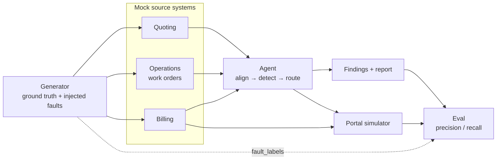

# valwell-q2c-agent

A demo **quote-to-invoice reconciliation agent** for an oilfield service company, modelled on a valve and wellhead
remanufacturing shop.

Quoting and billing usually live in disconnected systems, and money leaks in the gap between them. Prices drift
from the contracted price book, scope grows after teardown without an approved change order, and parts are marked
up past the contract cap. The result is rejected invoices, slow payment and revenue written off. This agent sits
between the systems. Before an invoice is sent, it lines up **quote ↔ work order ↔ invoice ↔ price book** line by
line, checks customer rules, and raises evidence-backed findings with suggested fixes for a human to approve.

> **Status:** early development. M0 (repository foundation) is in progress. See [the roadmap](#roadmap).

## Architecture



- **Generator:** builds a fully correct remanufacturing job (TDI quote → TDI findings → repair quote → work order
  → invoice), then injects labelled faults, so every batch is an evaluation set that comes with answers.
- **Mock systems:** each system keeps its own JSON store and never reads another's. The portal simulator accepts or
  rejects invoices against the customer's rules.
- **Agent:** deterministic first. It aligns lines, runs one pure detector per friction code and routes each finding
  to auto-fix, review or block. An LLM is used only to draft text, and guards stop it from producing numbers.
- **Eval:** scores findings against the fault labels and compares portal acceptance with and without the agent.

Frictions in v1: **A1** stale price, **A3** markup over cap, **B1** post-teardown scope change without an approved
change order. Design rationale: [ADR 0001](docs/adr/0001-typescript-monorepo.md).

## Repository layout

```
packages/domain        zod schemas, Money (integer cents), shared types (no I/O)
packages/generator     seeded ground-truth generator and fault injectors
packages/mock-systems  quote / ops / billing stores and portal simulator
packages/rules         pure customer-rule functions
packages/agent         adapters, pipeline nodes, report
packages/eval          metrics and experiment runner
apps/web               review UI (later)
data/fixtures          small committed sample batches
docs/adr               architecture decision records
```

## Getting started

Requires Node 24 (see `.node-version`) and pnpm (version pinned in `package.json`).

```sh
pnpm install
pnpm check
```

| Command | Purpose |
| --- | --- |
| `pnpm install` | Install dependencies and git hooks |
| `pnpm check` | Lint, typecheck and test. Must pass before every commit |
| `pnpm lint` / `pnpm format` | Biome check / Biome fix |
| `pnpm typecheck` | `tsc -b` across workspaces |
| `pnpm test` | Vitest, all packages |
| `pnpm generate -- --seed 42 --jobs 50` | Generate a synthetic batch *(from M2)* |
| `pnpm agent -- --batch data/<batch>` | Run the agent and write a findings report *(from M4)* |
| `pnpm eval -- --batch data/<batch>` | Score findings against fault labels *(from M5)* |

## Roadmap

| Milestone | Scope |
| --- | --- |
| M0 | Repository foundation: tooling, hooks, CI, docs |
| M1 | Domain model (zod schemas) |
| M2 | Generator with A1 / A3 / B1 fault injection |
| M3 | Mock systems, rules and portal simulator |
| M4 | Agent v0 (deterministic pipeline and report) |
| M5 | Evaluation harness and a CI recall gate |
| M6 | LLM drafting of change orders, with guards |
| M7 | Next.js review UI |
| M8 | Docker image and CD to GHCR |

## Contributing

See [CONTRIBUTING.md](CONTRIBUTING.md). The full rulebook is [CLAUDE.md](CLAUDE.md).
